# Talk Recap

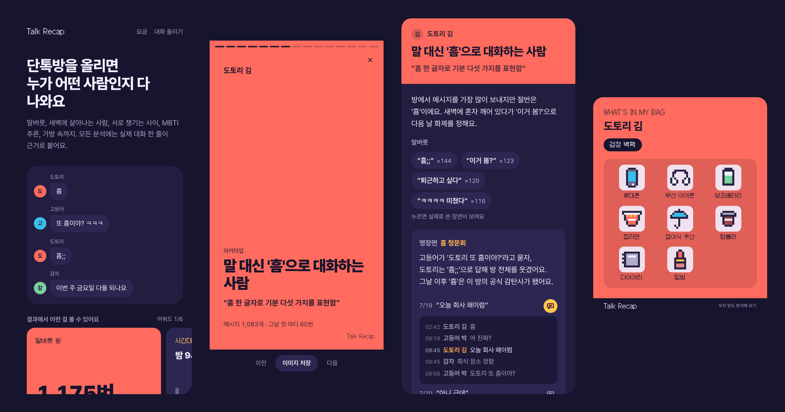

**카카오톡 단톡방 대화 파일을 올리면, AI가 멤버마다 성격·말버릇·명장면·궁합·MBTI·가방 속을 "연말 결산(Wrapped)" 형식으로 보여주는 유료 웹 서비스.**
모든 분석에는 실제 대화 한 줄이 근거로 붙고, 대화 원문은 서버에 저장하지 않아요.

| | |
|---|---|
| 기간 | 2026.10 ~ |
| 역할 | 1인 기획·디자인·프론트엔드·백엔드 (AI 코딩 에이전트와 협업) |
| 상태 | 토스페이 입점 심사 완료, 유료 상품 2종(라이트 900원 / 1년 분석 1,900원) |
| 스택 | Next.js 16 · React 19 · TypeScript · Tailwind CSS 4 · Jotai · TanStack Query · Web Worker · OpenAI API · Zod · Supabase · 토스페이 · Vercel |
| 규모 | 화면 12개, API 라우트 11개, 테스트 98개(Vitest) |

> 스크린샷의 이름·대화는 모두 지어낸 샘플이에요.

## 주요 화면

| 대화 올리기 | 멤버 확인 | 분석 중 |
|:---:|:---:|:---:|
| 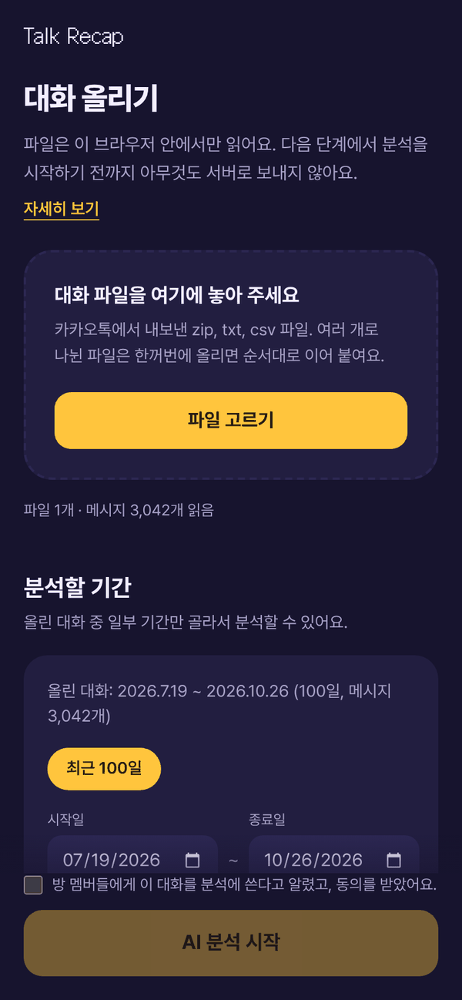 | 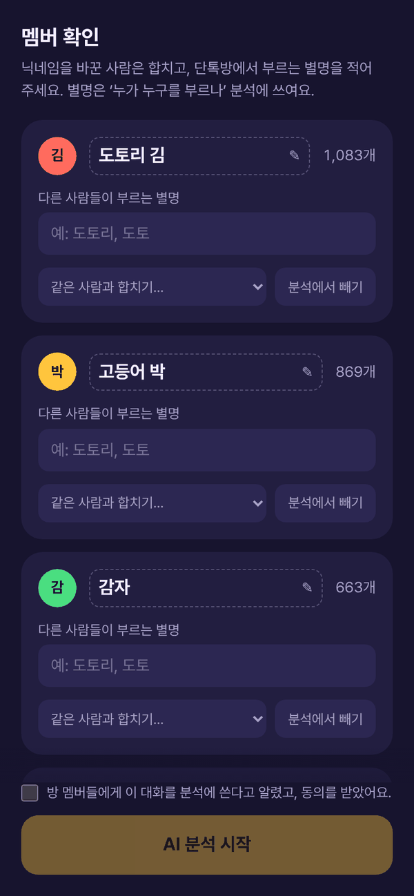 | 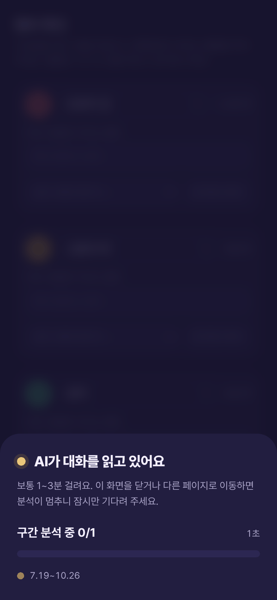 |
| 파일은 브라우저 안에서만 읽고, 기간을 골라 분석 | 닉네임 묶기·이름 바꾸기·봇 제외·별명 입력 | 구간별 병렬 분석 진행 상황을 오버레이로 |

| 결과 스토리 | 결과 리포트 | 멤버 카드 |
|:---:|:---:|:---:|
| 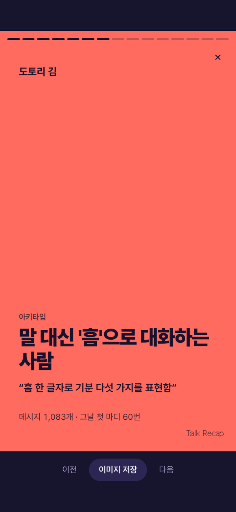 | 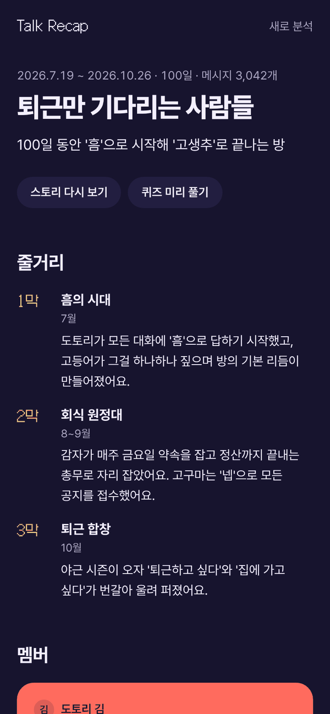 | 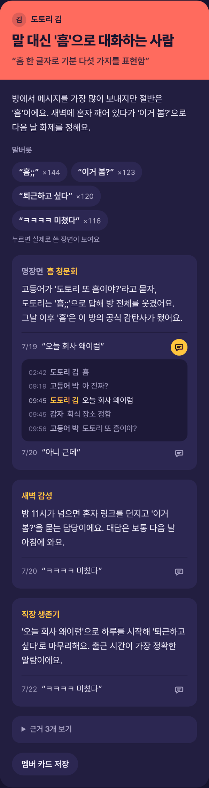 |
| 인스타 스토리처럼 넘기는 10여 장, 장마다 이미지 저장 | 줄거리 3~5막, 멤버, 궁합, MBTI, 어워드, 총평 | 말버릇(실제 문장·횟수), 명장면, 사람마다 다른 꼭지 |

| 근거와 앞뒤 대화 | 궁합·MBTI | 가방 카드 · 퀴즈 |
|:---:|:---:|:---:|
| 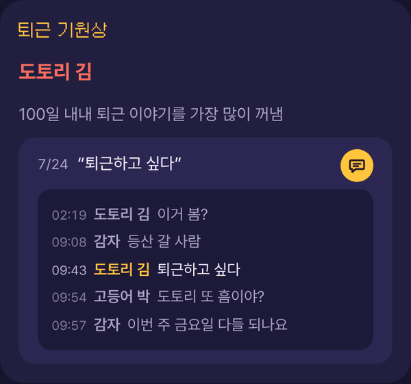 | 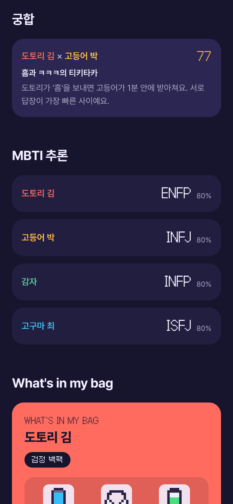 | 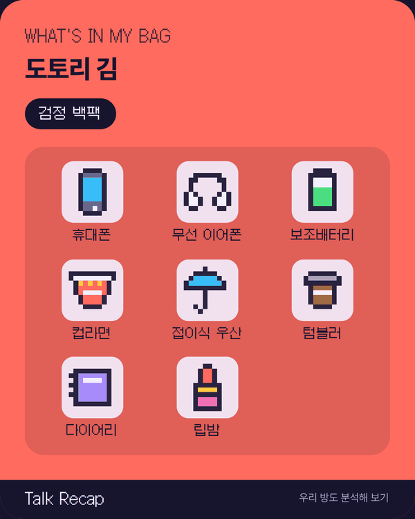<br>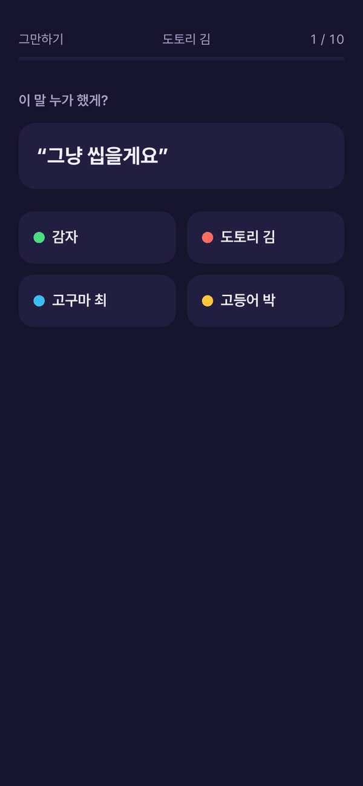 |
| 인용 옆 아이콘을 누르면 앞뒤 2줄씩 펼쳐 문맥 확인 | 쌍별 궁합 점수, 행동으로 추론한 MBTI와 축별 근거 | 픽셀 아이콘 가방 카드(PNG 저장), "이 말 누가 했게?" 퀴즈 |

## 이렇게 동작해요

```
[브라우저]
  파일(zip/txt/csv) ─▶ Web Worker: 형식 감지 → 파싱 → 멤버 묶기 → 통계 → 구간 분할 + 민감정보 마스킹
                       (대화 원문은 워커 메모리에만 있음)
  "AI 분석 시작" ─▶ 기간·요금 확인 → 토스페이 결제
                ─▶ 구간 텍스트를 동시 3개씩 ─▶ [서버] /api/analyze/chunk ─▶ OpenAI (구간 노트)
                                                   인용을 구간 원문과 대조
                ─▶ 노트 + 코드로 계산한 통계 ─▶ [서버] /api/analyze/synthesize ─▶ OpenAI (최종 리포트)
                                                   인용 재검증, 근거 없는 꼭지 제거
  워커가 결과에 쓰인 인용의 앞뒤 2줄만 뽑아 붙임 ─▶ localStorage ─▶ /r/[id]
  (선택) 공유 ─▶ Supabase에 30일 저장 ─▶ /s/[id]  (퀴즈 순위·반박 투표를 Realtime으로 같이)
```

## 기술 선택

| 영역 | 기술 | 고른 이유 |
|---|---|---|
| 프레임워크 | Next.js 16 (App Router, Cache Components), React 19 | 화면과 AI·결제·공유 API를 한 레포에서 관리. 공유 페이지는 서버 렌더 + OG 이미지 |
| 스타일 | Tailwind CSS 4 `@theme` 토큰, Pretendard·Galmuri | 직접 만든 다크 테마 디자인 시스템, 모바일 우선 |
| 상태 | Jotai, TanStack Query | 업로드→분석→결과 단계 상태는 작은 atom으로, 분석·공유 요청은 뮤테이션·재시도로 |
| 파싱 | Web Worker, JSZip | 수십만 줄 대화도 화면 멈춤 없이, 원문을 메인 스레드·서버로 꺼내지 않고 처리 |
| AI | OpenAI Structured Outputs(strict), Zod 4 | Zod 스키마 하나로 응답 검증과 JSON Schema를 같이 써서 출력 형식을 강제 |
| 데이터 | Supabase (Postgres, RLS, Realtime Broadcast) | 무료로 시작해 공유 링크·퀴즈 기록·반박 투표를 저장하고 실시간 반영 |
| 결제 | 토스페이 직접 계약 API | 분석을 시작할 때 결제, 회원가입 없이 주문 소유 확인 |
| 이미지 | html-to-image | 카드·스토리를 1080×1350, 1080×1920 PNG로 저장해 SNS에 공유 |

## 문제 해결

**1. 대화 원문을 서버에 남기지 않는 AI 분석**
- 문제: 단톡방 대화는 남의 말까지 담긴 민감한 데이터인데, AI 분석은 서버를 거쳐야 함
- 해결: 파싱·통계·구간 분할·민감정보 마스킹(전화·계좌·주민·카드번호, 이메일)을 Web Worker에서 처리. 서버 API는 구간 텍스트를 요청 메모리에서만 쓰고 로그·DB에 남기지 않음
- 결과: 서버에 남는 건 분석 결과뿐. 이 원칙을 `AGENTS.md`의 절대 규칙으로 두고 화면의 "내 대화는 어디로 가나요?" 안내와 맞춤

**2. AI가 지어낸 인용 걸러내기**
- 문제: LLM이 실제로 없는 말을 "인용"으로 만들어 내면 친구 사이에 오해가 생김
- 해결: 모든 인용을 구간 원문과 대조해 없는 문장은 버리고, 종합 단계에서 한 번 더 검증. 멤버 인용은 본인 말만, 어워드 인용은 수상자 말만 허용. 근거가 하나도 남지 않은 분석 꼭지는 통째로 제거
- 결과: 화면에 보이는 모든 인용이 실제 대화에 있는 문장. 인용 옆 아이콘으로 앞뒤 대화까지 확인 가능

**3. 원문 없이 "앞뒤 대화" 보여주기**
- 문제: 근거 한 줄만으로는 문맥을 알 수 없는데, 원문 전체를 저장할 수는 없음
- 해결: 분석이 끝나는 순간 워커에 결과 인용 목록을 넘겨, 인용 주변 2줄씩만 뽑아 결과와 함께 저장. 민감 주제가 들어간 줄은 가림
- 결과: 문맥 확인은 되면서 저장되는 원문은 인용 수 × 5줄로 제한

**4. 20만 메시지에서 생긴 콜스택 초과**
- 문제: 분할 파일을 합치는 `push(...arr)`가 큰 대화에서 `Maximum call stack size exceeded`로 실패
- 해결: 스프레드를 반복문으로 바꾸고 20만 메시지 회귀 테스트 추가. 큰 배열에 스프레드를 쓰지 않는 것을 팀 규칙으로 문서화
- 결과: 대용량 대화도 브라우저에서 바로 처리

**5. 비용과 정확도를 함께 잡는 2단계 분석**
- 문제: 긴 대화를 한 번에 좋은 모델로 보내면 비싸고, 숫자(메시지 수, 시간대 등)를 LLM이 틀리게 셈
- 해결: 날짜 경계로 자른 구간을 저렴한 모델로 병렬 분석(동시 3개, 최대 3번 재시도)하고, 좋은 모델은 종합에 1번만. 통계는 코드로 계산해 프롬프트에 넣음
- 결과: 100일치 분석 1회 약 0.2~0.3달러, 수치는 항상 정확

**6. 회원가입 없는 공유·결제**
- 문제: 가입 없이 쓰는 서비스에서 "이 공유 링크·주문이 내 것"임을 확인해야 함
- 해결: 공유 삭제 토큰과 주문 비밀값은 브라우저에만 주고 DB엔 sha256 해시만 저장, RLS로 공개 접근 차단. 공유 결과는 30일 뒤 자동 만료
- 결과: 계정 없이도 본인만 공유를 지우고 결제를 사용할 수 있음

**7. 저장된 결과를 깨지 않는 스키마 변경**
- 문제: 리포트 구조를 자주 바꾸는데, 이미 브라우저와 공유 DB에 저장된 예전 결과도 열려야 함
- 해결: 읽을 때 예전 모양을 지금 모양으로 맞추는 정규화 계층을 두고, 공유 스키마는 두 모양을 다 받게 함. 서비스 이름을 바꿀 때는 브라우저 저장소 키를 처음 접근 시 자동으로 옮김
- 결과: 기능을 계속 붙여도 기존 사용자 데이터가 그대로 열림

**8. 결제 심사 대응**
- 토스페이 입점 심사 반려 사유(무형 상품의 서비스 제공 기간, 환불 정책)를 확인하고, 이용약관·환불 정책 페이지·결제 화면의 제공 기간 안내와 사업자 정보 표시를 보완해 심사 완료

## 이력서용 요약

- 카카오톡 대화를 AI로 분석하는 유료 웹 서비스 Talk Recap을 1인 기획·디자인·개발하고 토스페이 결제까지 연동 (Next.js 16, OpenAI, Supabase)
- 대화 원문이 서버에 남지 않도록 파싱·마스킹을 Web Worker로 옮기고, LLM 인용을 원문과 대조해 근거 없는 결과를 자동 제거
- 저가 모델 병렬 분석 + 고가 모델 1회 종합, 통계는 코드로 계산하는 구조로 100일치 분석 비용을 회당 약 0.2~0.3달러로 설계
- 회원가입 없이 토큰 해시로 공유·결제 소유를 확인하고, Supabase Realtime으로 퀴즈·반박 투표를 실시간 반영
- `AGENTS.md`·`docs/TASKS.md`로 규칙과 작업 단위를 문서화해 여러 AI 코딩 에이전트에 작업을 나눠 맡기며 빠르게 MVP를 내고 기능을 확장

---

## 개발자용

> 에이전트로 작업한다면 [`AGENTS.md`](AGENTS.md)부터 읽기. 문서: [PRD](docs/PRD.md) · [남은 작업](docs/TASKS.md) · [설정](docs/SETUP.md) · [구조](docs/ARCHITECTURE.md)

### 실행

```bash
npm install
cp .env.example .env.local   # OPENAI_API_KEY 등 채우기 (없으면 목업 모드)
npm run dev                  # http://localhost:3000
npm test                     # vitest
node scripts/make-sample.mjs > fixtures/sample-kakao.txt  # 가짜 샘플 대화 생성
```

- 키가 없으면 자동으로 목업 모드가 돼서 가짜 결과로 화면 흐름을 확인할 수 있어요.
- `OPENAI_CHUNK_MODEL`(구간 분석, 여러 번 호출)은 저렴한 모델, `OPENAI_SYNTH_MODEL`(종합, 1번)은 좋은 모델을 권장해요.
- 결과는 분석한 브라우저(localStorage)에 저장되고, 공유 링크를 만들면 Supabase에 30일 저장돼요.
- Supabase·Vercel·토스페이 설정은 [`docs/SETUP.md`](docs/SETUP.md)에 있어요.

### 지원하는 카카오톡 내보내기 형식

모바일(점·한글 날짜), PC 대괄호, 영문, CSV. 나뉜 파일은 순서대로 이어 붙여요.

### 개인정보 원칙

- 실제 대화 파일은 레포에 올리지 않는다 (`.gitignore`로 차단, 테스트·스크린샷은 지어낸 샘플만 사용)
- 원문은 브라우저 밖에 저장하지 않는다. AI 분석 단계에서도 구간 텍스트를 요청 메모리로만 쓰고, 결과에는 근거 인용과 그 앞뒤 몇 줄만 남긴다
